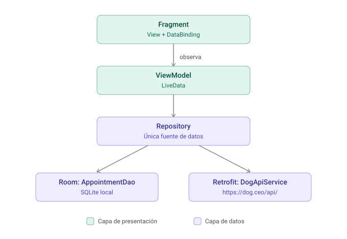

# DogApp — Agenda de citas para mascotas

Miniproyecto 1 · *Desarrollo de Aplicaciones para Dispositivos Móviles*, Universidad del Valle (sede Cali).
**Equipo:** EquipoOcho.

App Android que permite entrar con huella digital, ver las citas, crearlas, consultarlas, editarlas y eliminarlas. Las citas se guardan en SQLite con Room. Las razas y las fotos de perros se consumen de la API REST [dog.ceo](https://dog.ceo/dog-api/).

| | |
|---|---|
| Tablero Jira | https://dog-app-equipo-8.atlassian.net/jira/software/projects/KAN/boards/2 |
| Sprint 1 | 12-nov-2026 → **26-nov-2026** |
| Sprint 2 | ##-nov-2026 → **##-###-2026** |

## Equipo y responsabilidades

| Integrante | Trabajo en el sprint | Rama sugerida |
|---|---|---|
| Juan José Cortés Rodríguez | HT-01 Base UI y navegación · HT-02 Room · HT-03 Retrofit · **HU 2.0 Home** · revisión de PRs e integración | `feature/KAN-<n>-base-ui`, `feature/KAN-<n>-room`, `feature/KAN-<n>-retrofit`, `feature/KAN-<n>-home` |
| Alejandro Fernández Herrera | **HU 1.0 Login** (biometría, Lottie, fuente, ícono) | `feature/KAN-<n>-login-biometria` |
| Jerson David Otero Cruz | **HU 3.0 Nueva Cita** | `feature/KAN-<n>-nueva-cita` |
| Juan Pablo Robayo Maestre | **HU 4.0 Detalle** · **HU 5.0 Editar Cita** | `feature/KAN-<n>-detalle-cita`, `feature/KAN-<n>-editar-cita` |

`<n>` es el número que Jira le asigna a la historia.

## Stack

| Requisito (HU / rúbrica) | Tecnología |
|---|---|
| Lenguaje y UI | Kotlin + XML (Material Components) con **DataBinding** |
| Arquitectura | **MVVM + Repository**; dependencias manuales en `DogApp` (sin Hilt) |
| Pantallas | **Single-Activity + Fragments + Navigation Component** (Safe Args) |
| Base de datos local | **SQLite con Room** |
| API REST | **Retrofit** + Gson → `dog.ceo` |
| Login | `androidx.biometric` (BiometricPrompt) + animación **Lottie** |
| Imágenes desde URL | Glide |

## Arquitectura

<p align="center">
  
</p>

**Reglas**
- El Fragment solo habla con su ViewModel.
- El ViewModel solo habla con los repositorios.
- Ningún Fragment usa directamente el DAO ni Retrofit.

```
app/src/main/java/com/equipoocho/dogapp/
├─ DogApp.kt                  # Application: contenedor de dependencias
├─ MainActivity.kt            # aloja el NavHostFragment
├─ data/
│  ├─ local/                  # Room: AppointmentEntity, AppointmentDao, AppDatabase
│  ├─ remote/                 # Retrofit: DogApiService, RetrofitClient, dto/
│  └─ repository/             # AppointmentRepository, BreedRepository
└─ ui/
   ├─ common/                 # ViewModelFactory, BindingAdapters (imageUrl con Glide)
   ├─ login/                  # HU 1.0
   ├─ home/                   # HU 2.0
   ├─ newappointment/         # HU 3.0
   ├─ detail/                 # HU 4.0
   └─ edit/                   # HU 5.0
```

### Contratos 

- `data/local/AppointmentEntity.kt`: campos de la cita. El `id` autogenerado es el "turno" (#n).
- `data/local/AppointmentDao.kt`, `data/remote/DogApiService.kt`, `data/repository/*`: firmas de los métodos.
- `res/navigation/nav_graph.xml`: destinos, IDs de acciones y argumento `appointmentId`.
- `res/values/strings.xml`, `colors.xml`, `arrays.xml`: textos literales de las HU, paleta (rosado `#F05861`) y lista de síntomas.
- `res/layout/layout_curved_toolbar.xml` y `ui/common/BindingAdapters.kt`: componentes reutilizables.

Cada archivo trae comentarios `TODO [KAN HUx.x] Cn` con el criterio de aceptación que le corresponde.

### Endpoints de dog.ceo
| Uso | Endpoint |
|---|---|
| Autocompletar la raza (HU 3.0 / 5.0) | `GET breeds/list/all` |
| Foto de la mascota según su raza (HU 3.0 / 5.0, "Importante") | `GET breed/{raza}/images/random` |

## Cómo correr el proyecto
1. Clonar: `git clone https://github.com/JuanCortesRo/equipoOcho.git`. Luego `git checkout develop`.
2. En Android Studio: **File → Open**, elegir la carpeta del proyecto y esperar el *Gradle Sync*. Android Studio crea `local.properties` con la ruta de tu SDK.
3. Requisitos: SDK de Android con **API 37** y JDK 21 o superior (el JBR de Android Studio sirve).
4. Ejecutar en un emulador o dispositivo con **API 26 o superior**. Para probar la huella en el emulador:
   - Registra una huella en *Settings → Security*.
   - Usa *Extended controls → Fingerprint → Touch sensor*.

Para compilar por consola: `./gradlew assembleDebug`.

## Forma de trabajo
Las convenciones están en [CONTRIBUTING.md](CONTRIBUTING.md).
